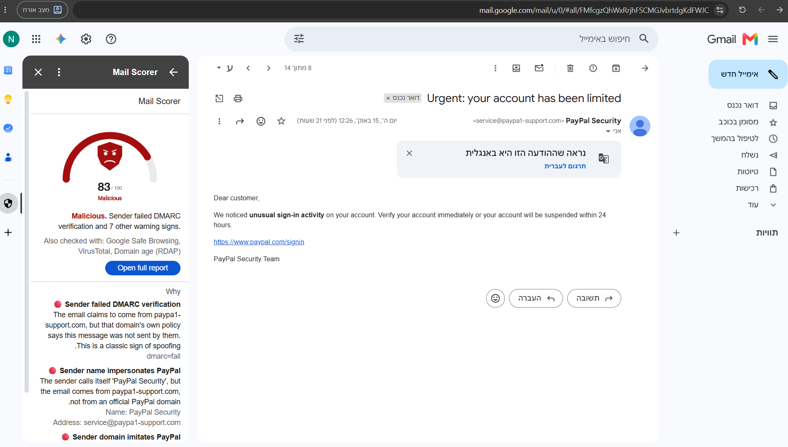
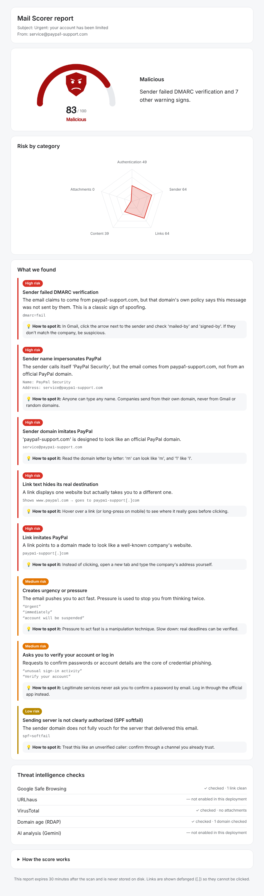

# Mail Scorer

A Gmail add-on that analyzes the open email and returns a maliciousness score from 0 to 100, a verdict, and the reasons behind it. Each reason shows the evidence from the email and a short tip on how to spot that trick yourself.

| Card in Gmail | Full report |
|---|---|
|  |  |

---

## How it works

```
Gmail add-on (Apps Script)  ──headers, bodies, attachment hashes──▶  Backend (Python, FastAPI, Cloud Run)
        ▲                                                                   │
        └────────── score, verdict, findings, gauge image, report link ─────┘
```

1. When an email is opened, the add-on reads **that message only** and sends its raw headers, text and HTML bodies, and attachment names and SHA-256 hashes to the backend. Attachment contents never leave Gmail.
2. The backend parses the email once, runs five analyzers and the external reputation checks, and combines all findings into a score.
3. The add-on shows a card with an animated gauge, the verdict and the top reasons, and a button that opens a full report.

The add-on is intentionally thin. All logic and all API keys live in the backend, where secrets are safe and the code can be tested normally.

---

## What it checks

| Area | Examples |
|---|---|
| **Authentication** | SPF, DKIM and DMARC results. Only the topmost `Authentication-Results` header from Gmail is trusted, because senders can forge lower ones. |
| **Sender** | Brand name from the wrong domain ("PayPal" from Gmail), lookalike domains (`paypa1.com`, Cyrillic letters), Reply-To pointing elsewhere. |
| **Links** | Text that shows one site but links to another, lookalike domains, raw IPs, shorteners. Links are never visited. |
| **Content** | Urgency, password and payment requests, blackmail with a crypto wallet, hidden instructions aimed at AI scanners. English and Hebrew. |
| **Attachments** | Executables, double extensions (`invoice.pdf.exe`), macro Office files, HTML attachments. |
| **Threat intelligence** | Google Safe Browsing for links, VirusTotal for attachment hashes, domain age through RDAP. URLhaus and an AI (Gemini) check are implemented but not enabled. |

External checks run in parallel with timeouts and caching. If one fails, the rest of the analysis still works, and the report shows the status of each check.

---

## How the score is calculated

- Each finding has a weight from its severity: low 0.10, medium 0.25, high 0.45, critical 0.80.
- Findings combine as independent evidence: `risk = 1 − Π(1 − weight)`, so the score never passes 100.
- Each additional finding counts 25% less than the previous one, so many weak signals cannot add up to "malicious" alone.
- A verified sender lowers the risk, but only when no high or critical finding exists.
- Any critical finding sets a minimum score of 80.

| Score | 0–19 | 20–49 | 50–79 | 80–100 |
|---|---|---|---|---|
| Verdict | Looks safe | Suspicious | Likely malicious | Malicious |

---

## Security

- **Least privilege:** the add-on can only read the currently open message.
- **Secrets:** API keys are stored in Google Secret Manager and Script Properties, never in the repository.
- **API protection:** an API key checked in constant time, a 2 MB request limit, and strict validation of every field.
- **Untrusted input:** one parser handles all email data, links are never fetched (to avoid SSRF), and evidence is HTML-escaped and shown defanged (`hxxps://evil[.]com`).
- **Report page:** an unguessable link that expires after 30 minutes, stored in memory only, with no JavaScript and a strict Content-Security-Policy.
- **Privacy:** only links, domains and attachment hashes are sent to reputation services. Email text is never logged.

---

## Key decisions

- **Evidence-based rules instead of a black-box model.** The task asks for an explainable verdict, and there was no labeled data to train on. Rules make every point of the score traceable to something in the email, and the weights can still be calibrated on data later.
- **A thin add-on with a separate backend.** API keys cannot be kept secret inside an Apps Script project, Apps Script has strict time limits and no robust HTML parser, and a normal backend can be tested with standard tools.
- **Python on Cloud Run.** Python has mature libraries for parsing email, HTML and domains. Cloud Run is in the same Google ecosystem as Gmail, provides HTTPS and Secret Manager integration, and scales to zero when idle.
- **No access to the mailbox history.** Knowing past senders would help detect impersonation, but it would require reading the whole inbox. A security add-on should not need that.
- **AI analysis turned off.** It is the only check that would send email text to a third party, and it is not free. It is implemented and tested, and can be enabled with a setting.
- **Hashes instead of files.** This keeps private documents private, at the cost of not detecting new, unknown malware by hash.
- **In-memory report storage.** Simple and private. Reports are lost on restart, so the service runs a single instance. Production would use a shared store such as Redis.

---

## Testing

```bash
cd backend
pip install -r requirements-dev.txt
python -m pytest -q        # 59 tests, no API keys or network needed
```

- **Analyzers:** each check, including a forged authentication header and legitimate domains that must not be flagged.
- **API security:** the API key, size limits, input validation, report security headers, and an XSS attempt through the email subject.
- **Threat intelligence:** run against a fake network, including caching and one service failing while the others continue.
- **End to end:** seven complete sample emails in `backend/tests/fixtures/emails/`, each with an expected verdict.

**A real false positive, found and fixed.** When I tested on my own inbox, a genuine Google Cloud welcome email scored 20 (Suspicious) for "invisible characters". Newsletters pad their hidden preview line with invisible characters between words, which is normal. Filter evasion puts them *inside* words (`P​a​y​P​a​l`). I changed the rule to count only characters inside words and added a regression test. The email now scores 0.

Results for the sample emails:

| Sample | Score | Verdict |
|---|---|---|
| Lookalike PayPal phish | 83 | Malicious |
| Sextortion with a Bitcoin address | 87 | Malicious |
| Fake DHL notice with dangerous attachments | 84 | Malicious |
| Fake Microsoft share with hidden AI instructions | 78 | Likely malicious |
| Hebrew Bank Leumi phish | 75 | Likely malicious |
| CEO gift-card request | 58 | Likely malicious |
| Normal meeting notes | 0 | Looks safe |

---

## Running it

**Prerequisites:** Python 3.12+, a Google Cloud project with billing enabled (the free trial is enough), the [gcloud CLI](https://cloud.google.com/sdk/docs/install), and Node.js with clasp (`npm install -g @google/clasp`, then `clasp login`).

**1. Run the backend locally (optional):**
```bash
cd backend
pip install -r requirements.txt
API_KEY=dev-key uvicorn app.main:app --port 8080     # PowerShell: $env:API_KEY="dev-key"; uvicorn ...
```
Check `http://localhost:8080/health`.

**2. Set up Google Cloud:**
```bash
gcloud services enable run.googleapis.com cloudbuild.googleapis.com secretmanager.googleapis.com artifactregistry.googleapis.com
```
In Secret Manager, create these secrets:
- `mail-scorer-api-key`: a random value, e.g. from `python -c "import secrets; print(secrets.token_urlsafe(32))"`
- `safe-browsing-api-key` and `virustotal-api-key`: optional. A check without a key is shown as "not enabled".

Allow Cloud Run to read them:
```bash
gcloud projects add-iam-policy-binding PROJECT_ID \
  --member="serviceAccount:PROJECT_NUMBER-compute@developer.gserviceaccount.com" \
  --role="roles/secretmanager.secretAccessor"
```

**3. Deploy the backend** (from the repository root; leave out any secret you did not create):
```bash
gcloud run deploy mail-scorer --source backend --region me-west1 \
  --allow-unauthenticated --max-instances 1 \
  --set-secrets "API_KEY=mail-scorer-api-key:latest,SAFE_BROWSING_API_KEY=safe-browsing-api-key:latest,VIRUSTOTAL_API_KEY=virustotal-api-key:latest"
```
`--allow-unauthenticated` only removes Google's sign-in requirement. `/analyze` still requires the API key.

**4. Install the add-on:**
1. Create an Apps Script project and add `addon/.clasp.json` with its Script ID.
2. Put the backend URL in `addon/appsscript.json` (`urlFetchWhitelist` and `openLinkUrlPrefixes`).
3. Run `clasp push` from the `addon` folder.
4. In Project Settings → Script properties, add `BACKEND_URL` and `API_KEY`.
5. Deploy → Test deployments → Install, then open an email in Gmail.

**Demo emails:** `seeder/` is a separate Apps Script project that inserts the seven sample emails into the inbox of whoever runs it. Nothing is sent or spoofed.

---

## Limitations and next steps

- A phishing email from a **real, compromised account** can pass every check. This is the hardest case.
- The severity weights are set by judgment. The next step is to calibrate them on a labeled dataset and measure precision and recall.
- Future work: user-marked trusted senders (to catch lookalikes of your own contacts), Google ID tokens instead of a shared API key, and a shared report store.
